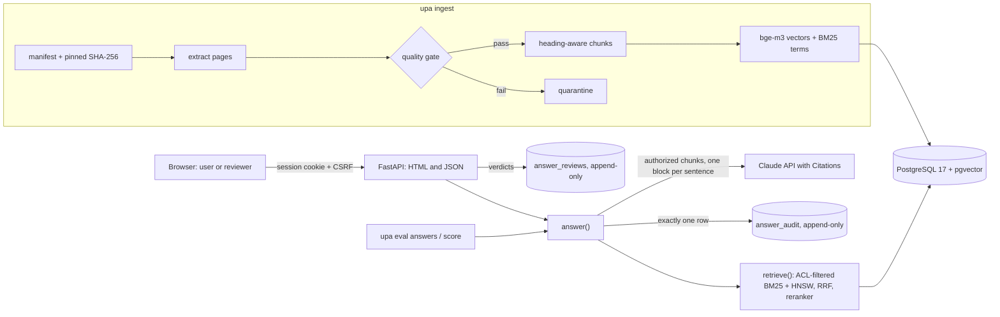

# Urdu–English Policy Assistant

[](https://github.com/lamebrowndev/urdu-english-policy-assistant/actions/workflows/ci.yml)

A bilingual Urdu/English assistant for an organisation's policies. Every answer
cites the exact source sentences, uses only the documents the asking user is
allowed to read, and is written to an append-only audit log that reviewers
score in the same web UI used for evaluation.

> **Status.** The system is built end to end, through the evaluation harness.
> **No accuracy number is claimed yet.** The headline metric, human-scored
> accuracy on a frozen 200-question Urdu/English test set, needs the real
> policy corpus and human reviews; the protocol is in
> [docs/EVALUATION.md](docs/EVALUATION.md). The bundled sample corpus is
> fictional.

## What it does

- **Hybrid retrieval in one PostgreSQL.** BM25 computed in SQL over an
  Urdu-normalized inverted index, bge-m3 vectors in pgvector (HNSW), reciprocal
  rank fusion, and a bge-reranker-v2-m3 cross-encoder. An Urdu question can find
  an English policy.
- **Sentence-exact citations.** Each retrieved chunk goes to Claude as a
  custom-content document with one block per sentence, so every citation maps to
  stored sentences. No valid citation, no answer.
- **Document-level permissions.** Default-deny ACLs are applied inside both
  retrieval queries and re-checked before the model call. Restricted and missing
  topics get byte-identical replies, so a refusal never reveals that a
  restricted document exists.
- **Append-only audit log.** Once retrieval has run, every question writes
  exactly one row: the question, the principal, the exact chunks and sentences
  sent, the model, request id, usage, and outcome, including failures.
  Database triggers reject UPDATE, DELETE, and TRUNCATE.
- **Human review and evaluation.** Reviewers only see answers whose sources they
  may read. The same review screen scores evaluation runs over frozen test sets,
  with Wilson 95% intervals by language, category, and question type.
- **Bilingual web UI.** Server-rendered and usable without JavaScript, with a
  strict CSP (no inline code), CSRF tokens plus same-origin checks, per-block
  `lang`/`dir`, and a self-hosted Noto Nastaliq Urdu font.
- **Fail-closed Urdu PDF ingestion.** Pages whose text layer is broken (private-use
  glyphs, wrong script, reversed text, low dictionary hit rate) are quarantined,
  never indexed.

## Architecture



An answer goes through two gates. The retrieval gate abstains without calling
the model when nothing relevant is found. The model gate abstains when Claude
replies `NO_ANSWER`, refuses, or cites nothing. Uncited model text is kept in the
audit row for reviewers and never shown to users.

## Quickstart

Requires Docker and [uv](https://docs.astral.sh/uv/); uv installs Python 3.13.

```bash
export ANTHROPIC_API_KEY=...   # or: ant auth login
make demo
```

`make demo` starts PostgreSQL 17 with pgvector, applies the migrations, ingests
the fictional sample corpus, creates a reviewer named `demo` with a random
password it prints once, and serves the UI at <http://127.0.0.1:8000>. The first
ingest downloads bge-m3 and bge-reranker-v2-m3 (about 4.6 GB) into the Hugging
Face cache; afterwards `export HF_HUB_OFFLINE=1` keeps model loading local.

The same steps by hand:

```bash
make setup && make db-up
uv run upa db migrate
uv run upa ingest --manifest corpus/manifest.sample.yaml
uv run upa user add alice --display-name Alice --role reviewer --group all_staff
UPA_SESSION_COOKIE_SECURE=false uv run upa serve
```

`UPA_SESSION_COOKIE_SECURE=false` is only for plain-http local use; keep Secure
cookies behind HTTPS. The API key is read by the Anthropic SDK and is never
written to the repository, logs, or audit rows.

## Using it

**Web UI.** Ask in Urdu or English, follow citation numbers to the cited
sentences, and switch the interface between English and اردو. Reviewers and
admins get a review queue showing, for each answer, what the user saw, the
retrieved context with cited sentences highlighted, and a verdict form.

**CLI.** The operator tool, which is trusted with database credentials:

```bash
uv run upa ask "ملازمین کو کتنے دن کی سالانہ چھٹی ملتی ہے؟" --group all_staff
uv run upa retrieve "approval limits" --group finance --mode hybrid_rerank
uv run upa audit list --limit 10
uv run upa user list
```

**HTTP API.** JSON endpoints under `/api` (login, ask, history, review). The
client never sends groups, roles, or user ids; the server reads them from the
session on every request.

```bash
JAR="${TMPDIR:-/tmp}/upa-cookies.txt"
CSRF=$(curl -s -c "$JAR" -X POST http://127.0.0.1:8000/api/auth/login \
  -H 'Content-Type: application/json' \
  -d '{"username":"alice","password":"your-password"}' | python3 -c 'import json,sys; print(json.load(sys.stdin)["csrf_token"])')
curl -s -b "$JAR" -X POST http://127.0.0.1:8000/api/ask \
  -H 'Content-Type: application/json' -H "X-CSRF-Token: $CSRF" \
  -d '{"question":"How many days of annual leave do employees get?"}'
```

## Evaluation

```bash
uv run upa eval answers --dataset evals/answers.sample.jsonl --split sample   # pipeline check
uv run upa eval freeze  --dataset evals/answers.test.jsonl                    # once
uv run upa eval answers --dataset evals/answers.test.jsonl --split test
uv run upa eval score <run_id>
uv run upa eval retrieval --dataset evals/retrieval_seed.sample.jsonl        # retrieval ablations
```

Each question is asked as its own principal through the production answer path.
Answers are scored by humans in the review UI against a written rubric, and
reports stay `PRELIMINARY` until every item is scored. See
[docs/EVALUATION.md](docs/EVALUATION.md) for the dataset format, rubric, and
reporting rules.

## Security

Permissions are enforced in SQL and re-checked before the model call. Sessions
are server-side with hashed tokens; passwords use Argon2id; every unsafe request
needs a CSRF token; all output is autoescaped under a strict CSP; audit, review,
and evaluation records are append-only in the database. The threat model and
known gaps are in [docs/SECURITY.md](docs/SECURITY.md).

## Limitations

- No accuracy results yet; see the status note above.
- Prototype deployment: one process, no login rate limiting, no password reset
  or SSO, no TLS termination (run it behind an HTTPS proxy).
- Scanned PDFs without a text layer are quarantined, not OCRed.
- Urdu normalization and sentence splitting are rule-based.
- Questions and authorized policy text are sent to a third-party model API.

## Project layout

```
src/policy_assistant/
  cli.py          upa: db, corpus, ingest, stats, retrieve, ask, audit, user, serve, eval
  config.py       settings (UPA_ prefix, .env)
  db/             connection, migrations 0001–0005
  text/           normalization, language detection, sentences, BM25 terms
  ingest/         manifest, fetch, extraction, quality gate, chunking, pipeline
  retrieval/      ACLs, BM25, vectors, fusion, reranking, readiness, retrieval eval
  answering/      Claude client, prompts, documents, citations, service, audit store
  auth/           passwords, users, sessions
  reviews/        review queue, verdicts, history
  evaluation/     answer datasets, runner, scoring
  api/            FastAPI app and shared helpers
  web/            templates, i18n, rendering helpers, static assets and font
corpus/           manifests and the fictional sample policies
evals/            sample retrieval and answer datasets
docs/             roadmap, evaluation protocol, security model, ADRs
tests/            unit and integration tests
```

## Development

```bash
make check             # format check, lint, mypy --strict, unit tests
make test-integration  # needs the Docker database (test DB names must end in _test)
```

Tests use deterministic fakes and need no network or Claude API. Opt-in suites:
`UPA_MODEL_TESTS=1 uv run pytest -k real_model` loads the real models, and
`UPA_LLM_TESTS=1 uv run pytest -k live_llm` calls Claude. Configuration is
documented in [.env.example](.env.example).

Real corpora are never committed: a manifest stores each document's source URL
and pinned SHA-256, and fetched files stay under `data/` (git-ignored).

## Design decisions

Twelve ADRs in [docs/adr](docs/adr):
[single Postgres + pgvector](docs/adr/0001-single-postgres-pgvector.md),
[Urdu normalization](docs/adr/0002-urdu-text-normalization.md),
[fail-closed extraction](docs/adr/0003-extraction-quality-gate.md),
[default-deny ACLs](docs/adr/0004-default-deny-acls.md),
[BM25 in SQL](docs/adr/0005-bm25-in-sql.md),
[hybrid retrieval](docs/adr/0006-hybrid-retrieval.md),
[cited answers](docs/adr/0007-cited-answers.md),
[append-only audit log](docs/adr/0008-append-only-audit-log.md),
[accounts and sessions](docs/adr/0009-accounts-and-sessions.md),
[review workflow](docs/adr/0010-review-workflow.md),
[server-rendered UI](docs/adr/0011-server-rendered-ui.md), and
[answer evaluation](docs/adr/0012-answer-evaluation.md).
The phase history is in [docs/ROADMAP.md](docs/ROADMAP.md).

## License

MIT; see [LICENSE](LICENSE). The bundled Noto Nastaliq Urdu font is licensed
under the SIL Open Font License 1.1
(`src/policy_assistant/web/static/fonts/OFL.txt`).
